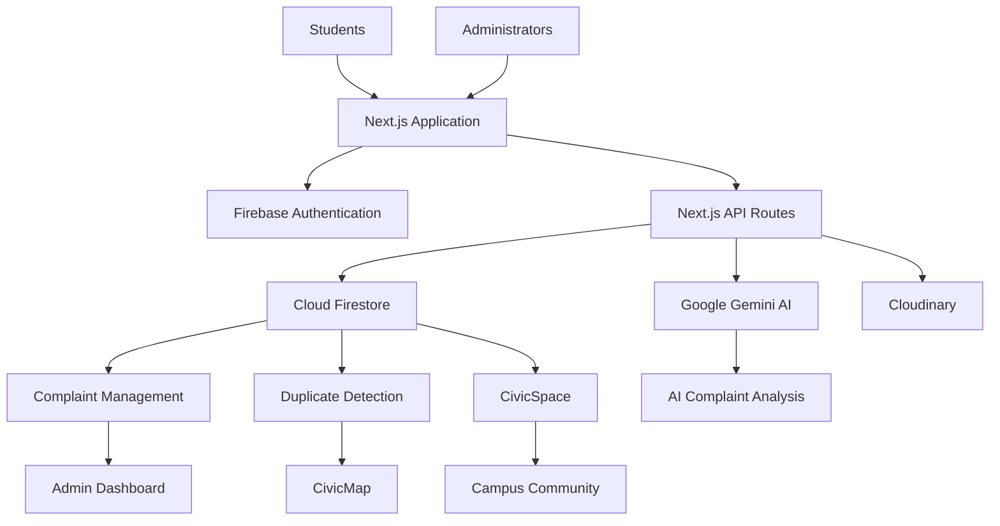

# CivicSense AI 🌱

### AI-Powered Campus Issue Reporting & Intelligence Platform

CivicSense AI is an intelligent campus management platform designed to make educational institutions more responsive, transparent, and connected.

It enables students to report campus problems, participate in community discussions, and track issue resolution, while administrators gain AI-powered tools to analyse complaints, identify recurring problems, and make data-informed decisions.

**Built for Game of Codes — ANAZORI V16.0 | Dibrugarh University**

---

## ✨ Key Features

### 🤖 AI-Powered Complaint Analysis
- AI-assisted complaint analysis using Google Gemini.
- Supports English and Assamese reporting.
- Automatically analyses complaint descriptions and categorises issues.
- Helps administrators understand and prioritise reported problems.

### 🔍 Duplicate Detection
- Identifies potentially duplicate complaints.
- Helps reduce repetitive reports.
- Detects recurring campus issues and patterns.

### 📍 CivicMap
- Interactive map for visualising reported campus issues.
- Geographic identification of issue hotspots.
- Helps administrators understand where problems are concentrated.
- Restricted to authenticated administrators through server-side authorisation.

### 🏛️ Student Dashboard
- Submit and manage complaints.
- Upload supporting images.
- Track complaint information and updates.
- Access campus community features.

### 🛡️ Admin Dashboard
- Centralised complaint management.
- Review and manage reported issues.
- Access AI-generated complaint insights.
- Monitor recurring issues and campus activity.

### 💬 CivicSpace
- Community discussions and campus updates.
- Posts, comments, and voting.
- A shared space for student participation and engagement.

### 📊 Campus Intelligence
- Insights into recurring campus problems.
- Geographic hotspot analysis.
- Better visibility into campus-wide issue patterns.

### 🎨 User Experience
- Responsive desktop and mobile interface.
- Light and dark themes.
- Image uploads with Cloudinary.
- Modern campus-focused design.

---

## 🛠️ Tech Stack

| Technology | Purpose |
|---|---|
| Next.js | Full-stack application framework |
| TypeScript | Type-safe development |
| React | User interface |
| Firebase Authentication | User authentication |
| Cloud Firestore | Database |
| Google Gemini AI | AI-powered complaint analysis |
| Cloudinary | Image storage and uploads |
| Leaflet | Interactive maps |
| OpenStreetMap | Map data |
| Vercel | Deployment |

---

## 🏗️ System Architecture



---

## 🚀 Getting Started

### Prerequisites

- Node.js (compatible with the project)
- npm
- Firebase project
- Google Gemini API key
- Cloudinary account

### 1. Clone the repository

```bash
git clone https://github.com/redux-next/civicsense-ai.git
```

### 2. Navigate into the project

```bash
cd civicsense-ai
```

### 3. Install dependencies

```bash
npm install
```

### 4. Configure environment variables

Create a `.env.local` file in the project root.

Configure your Firebase credentials, Gemini API key, Cloudinary credentials, and administrator email configuration according to the environment variable names used in the project.

Example:

```env
CIVICSENSE_ADMIN_EMAILS=admin@example.com
```

**Important:** Keep API keys and private credentials server-side. Never commit `.env.local` or expose secret keys in client-side code.

### 5. Start the development server

```bash
npm run dev
```

Open [http://localhost:3000](http://localhost:3000) in your browser.

### 6. Build for production

```bash
npm run build
```

---

## 🔐 Security

- Firebase Authentication for user identity.
- Role-based access control for administrative features.
- Server-side authorisation for protected administrator functionality.
- CivicMap and its APIs are restricted to authenticated administrators.
- Sensitive credentials are stored in environment variables.

---

## 🌍 Vision

CivicSense AI aims to transform traditional campus complaint systems into intelligent, transparent, and community-driven platforms.

By combining artificial intelligence, geographic intelligence, and student participation, it helps institutions identify problems, understand recurring patterns, and make better decisions.

**A smarter campus starts with a voice that gets heard.**

---

## 👨‍💻 Built With

Developed as a hackathon project for **Game of Codes — ANAZORI V16.0**, organised by the Centre for Computer Science and Applications, Dibrugarh University.

**Developer:** Gyanam

---

## 📄 License

This project is licensed under the [MIT License](LICENSE).

Copyright © 2026 Gyanam. All rights reserved.
